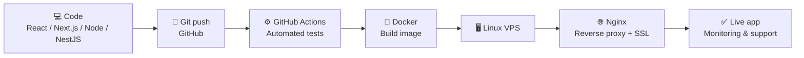

<!-- ═══════════════ HEADER BANNER ═══════════════ -->


<p align="center">
  <a href="https://github.com/medaminenasfi">
    
  </a>
</p>

<p align="center">
  
  
  
</p>

<p align="center">
  <a href="https://mohamedamine-portfolio.onrender.com/"></a>
  <a href="https://www.linkedin.com/in/mohamed-amine-nasfi"></a>
  <a href="mailto:medaminenasfy@gmail.com"></a>
</p>

---

## 👨‍💻 About Me

Full-stack developer who builds products **end to end**: from requirements and clean UI to REST APIs, secure payments, and production deployment on **Linux VPS** with **Docker**, **Nginx** and **CI/CD** pipelines.

```yaml
name:        Mohamed Amine Nasfi
role:        Full Stack Developer (React / Next.js / Node.js / NestJS) · DevOps
education:   Bachelor in Information Systems, ESSAT Gabès (Very Good honors)
location:    Gabès, Tunisia
languages:   [Arabic (native), French (professional), English (professional)]
open_to:     [Remote jobs, Freelance, Internships, Collaborations]
contact:     medaminenasfy@gmail.com
```

<table>
  <tr>
    <td align="center"><b>4</b><br/>client projects<br/>shipped to production</td>
    <td align="center"><b>CI/CD</b><br/>automated tests before<br/>every deployment</td>
    <td align="center"><b>-70%</b><br/>data entry time with a<br/>PHP/SQL automation tool</td>
    <td align="center"><b>Stripe + Twilio</b><br/>secure payments &<br/>OTP verification</td>
  </tr>
</table>

---

## 🛠️ Tech Stack

### 🖥️ Front-End
<p>
  
  
  
  
  
  
  
  
</p>

### ⚙️ Back-End & APIs
<p>
  
  
  
  
  
  
  
  
</p>

### 🚀 DevOps & Infrastructure
<p>
  
  
  
  
  
  
  
</p>

### 🗃️ Databases
<p>
  
  
  
  
</p>

### 📱 Mobile
<p>
  
  
  
</p>

### 🧰 Tools & Workflow
<p>
  
  
  
  
  
  
</p>

### 🤖 Python & Data
<p>
  
  
  
  
  
  
</p>

---

## 🚢 How I Ship to Production



---

## 💼 Experience

| Period | Role | Highlights |
|:--|:--|:--|
| **Nov 2025 – Present** | **Freelance Full-Stack Developer** (Remote) | 4 client apps from requirements to production · Docker, Nginx & Linux VPS administration · Stripe payments & Twilio OTP · GitHub Actions CI/CD with automated tests |
| **Feb – Jun 2025** | **Full-Stack Developer, Final Year Project** · *Laghazala du Désert* | MERN platform with external APIs, JWT auth and SSL · Agile sprints |
| **Jul – Aug 2024** | **Web Developer Intern** · *Groupe Chimique Tunisien (GCT)* | PHP/SQL automation tool that cut data entry time by **70%** for a team of 5 |

---

## 🚀 Featured Projects

| Project | Description | Stack |
|:--|:--|:--|
| **🎟️ Eventify** | Event booking platform (web + mobile) with secure Stripe checkout, Twilio OTP verification and JWT authentication | `Node.js` `PostgreSQL` `React` `Flutter` `Stripe` |
| **🏠 Real Estate Investment Platform** | REST API, onboarding flow, dynamic forms and an admin dashboard for lead management | `Next.js` `Node.js` `PostgreSQL` |
| **🕷️ Universal Web Scraper** | Python tool that auto-detects static vs dynamic websites, then extracts and cleans data | `Python` `Scrapy` `Selenium` `BeautifulSoup` `Pandas` |

<!-- Optional: add pinned repo cards. Replace YOUR-REPO with the real repository name.
<p align="center">
  <a href="https://github.com/medaminenasfi/YOUR-REPO">
    
  </a>
</p>
-->

---

## 📊 GitHub Analytics

<p align="center">
  
  
</p>

<p align="center">
  
</p>

---

## 🤝 Let's Work Together

<p align="center">
  I'm available for <b>remote jobs, freelance projects, and collaborations</b>.<br/>
  Need a web app built, deployed and maintained? Let's talk.
</p>

<p align="center">
  <a href="mailto:medaminenasfy@gmail.com"></a>
</p>


